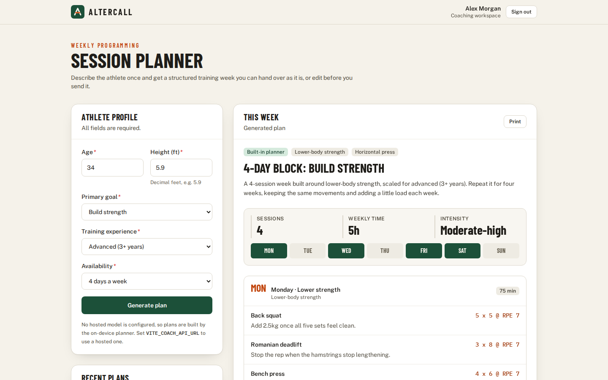
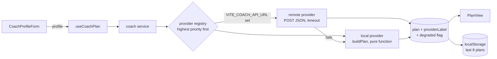
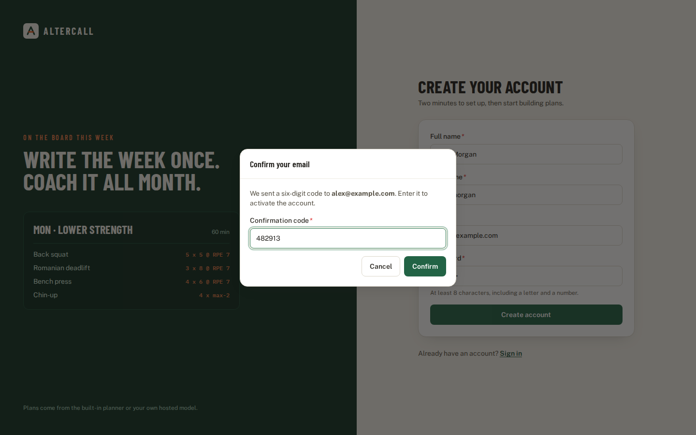
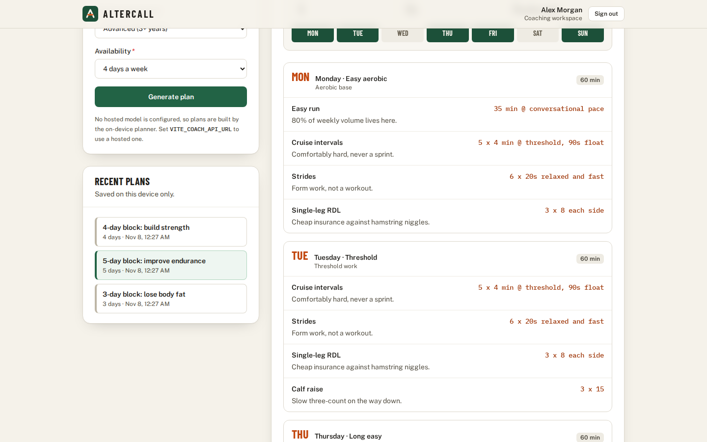
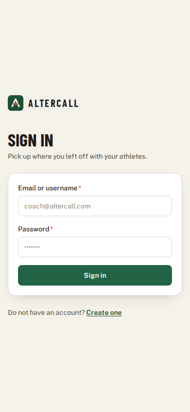
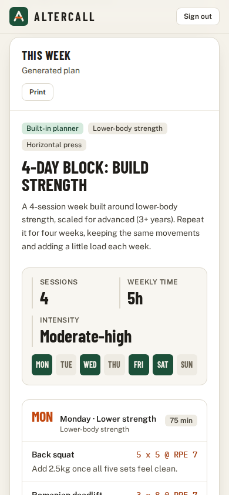

# AlterCall Web

Front end for the AlterCall coaching platform. A coach creates an account, confirms it with an emailed one-time code, signs in, and describes an athlete: age, height, goal, experience and how many days a week they can train. The app answers with a structured training week: which days to train, the movements for each session with sets, reps and effort, a weekly load summary, and coaching notes adjusted for the athlete.

The planner works with no backend at all. Accounts need a GraphQL API, and plans can optionally come from a hosted coaching model, with the built-in planner taking over if that model fails.



## What it does

- **Sign-up with OTP confirmation and sign-in** over GraphQL (Apollo Client). Sign-in accepts the email or the username the account was created with.
- **Weekly plan generator.** Four goals (strength, fat loss, endurance, mobility), three experience levels and 2 to 6 training days. Sessions are spread evenly across the week, and each one opens on a different movement.
- **Notes that follow the athlete.** The planner adds guidance by age band (under 18, 35+, 50+) and by height (long or short levers), plus an experience-specific progression note.
- **Hosted model with a fallback.** If `VITE_COACH_API_URL` is set, plans come from that endpoint first. A timeout, network error, bad status or unreadable body falls back to the built-in planner, and the plan is flagged so the coach knows.
- **Plan history** on the device: the last 8 plans, kept in `localStorage`, which can be reopened with one click.
- **Print view** that leaves out the header, form and history and keeps only the plan.
- **Session handling.** If the API rejects the stored token, the app signs the coach out straight away instead of showing a planner that can no longer make calls. Signing out in one tab signs out the others.

## Quick start (Docker)

```sh
docker compose up --build
```

Open http://localhost:8560. The image builds the bundle on Node 22 and serves it from an unprivileged nginx on port 8080, mapped to `${WEB_PORT:-8560}`.

Vite inlines `VITE_*` values at build time, so they are passed as build args. Export them in your shell or put them in a `.env` file next to `docker-compose.yml`, then rebuild:

```sh
VITE_GRAPHQL_URI=https://api.example.com/graphql docker compose up --build
```

## Local development

Requires Node 22 (`.nvmrc`).

```sh
nvm use
npm ci
cp .env.example .env.local
npm run dev
```

The dev server runs on http://localhost:3000.

The planner page sits behind sign-in. Without an auth server, open the browser console on the sign-in page, set a demo session, and reload:

```js
localStorage.setItem(
  "altercall.session",
  JSON.stringify({ accessToken: "dev", userName: "Alex Morgan" })
);
```

### Configuration

| Variable                | Default                         | Purpose                                                                   |
| ----------------------- | ------------------------------- | ------------------------------------------------------------------------- |
| `VITE_GRAPHQL_URI`      | `http://localhost:8000/graphql` | GraphQL endpoint for sign-up, confirmation and sign-in                    |
| `VITE_COACH_API_URL`    | empty                           | Hosted coaching endpoint. Leave it empty to use only the built-in planner |
| `VITE_COACH_TIMEOUT_MS` | `12000`                         | Abort the hosted call (headers and body) after this many milliseconds     |
| `WEB_PORT`              | `8560`                          | Host port for `docker compose`                                            |

The browser never holds a model API key. `VITE_COACH_API_URL` should point at a server-side endpoint that does.

## How a plan is made



Providers share one shape, `{ id, label, priority, isAvailable(), createPlan(profile) }`, and are kept in a small registry (`src/services/coach/registry.js`). The UI never knows which provider answered beyond the label it shows. Adding another source of plans, such as a canned plan for a demo account, means registering one more object.

`useCoachPlan` numbers each request and drops answers that arrive after a newer request, or after the coach has reopened a saved plan, so a slow hosted call can never replace what is on screen.

### Hosted coaching endpoint

The remote provider sends the profile as JSON:

```http
POST <VITE_COACH_API_URL>
Content-Type: application/json

{"age":34,"height":5.9,"goal":"strength","experience":"advanced","daysPerWeek":4}
```

It accepts either the same structured plan the built-in planner produces (`headline`, `summary`, `focusAreas`, `weeklyLoad`, `sessions[]`, `coachingNotes[]`) or a plain `{ "workoutSuggestion": "..." }` string, which is shown as the plan summary.

### GraphQL operations

The three mutations live in `src/features/auth/api/mutations.js`:

```graphql
mutation SignUp($username: String!, $name: String!, $password: String!, $email: String!) {
  signup(username: $username, name: $name, password: $password, email: $email) {
    user {
      username
      email
    }
  }
}

mutation UserConfirmation($username: String!, $otp: String!) {
  confirmUser(username: $username, otp: $otp) {
    success
  }
}

mutation Signin($username: String!, $password: String!) {
  signin(username: $username, password: $password) {
    accessToken
    refreshToken
    userId
    userName
    userEmail
  }
}
```

A sign-in response that the app treats as a success looks like this. These are the demo values the screenshot script serves, not output from a live server:

```json
{
  "data": {
    "signin": {
      "accessToken": "demo-access-token",
      "refreshToken": "demo-refresh-token",
      "userId": "u-demo",
      "userName": "Alex Morgan",
      "userEmail": "alex@example.com"
    }
  }
}
```

A `null` `signin` payload, which some servers return for bad credentials, is shown as a failed sign-in. An error with code `UNAUTHENTICATED` or `FORBIDDEN`, or an HTTP 401, on any later request clears the session.

## Screens

| Sign-up and email confirmation                                                                 | Reopening a saved plan                                                                        |
| ---------------------------------------------------------------------------------------------- | --------------------------------------------------------------------------------------------- |
|  |  |

On a phone the profile form, saved plans and the plan stack in one column:

| Sign-in                                                                                       | Generated plan                                                                                                 |
| --------------------------------------------------------------------------------------------- | -------------------------------------------------------------------------------------------------------------- |
|  |  |

The screenshots are taken with `scripts/capture-screenshots.mjs` against a production build, with every GraphQL call answered from demo fixtures.

## Project layout

```
src/
  app/                  routes and the provider tree (Apollo, session, router)
  components/ui/        Button, Field, Modal (native <dialog>), Panel, Alert, ...
  config/env.js         the only place that reads VITE_* values
  features/auth/        sign-up, OTP, sign-in, session context, route guard
  features/coach/       planner page, profile form, plan view, history
  lib/                  storage (with an in-memory fallback) and form validation
  services/apollo/      Apollo client with the auth header and the sign-out link
  services/coach/       planner, provider registry, local and remote providers
```

## Tests and checks

```sh
npm test               # Vitest + Testing Library, jsdom
npm run test:coverage  # with the 85/70/80/85 coverage thresholds
npm run lint           # ESLint 9 with react, hooks and jsx-a11y rules
npm run format:check
npm run build
```

The suite has 154 tests in 19 files. They cover the planner, the provider chain and its fallback, the remote provider's error mapping and timeouts, storage edge cases, validation, the Apollo auth and sign-out links, and the auth and planner screens through mocked GraphQL.

## Design notes

- **No UI kit.** The app needs a handful of controls, so they are small local components on Tailwind. The confirmation dialog uses the native `<dialog>`, which provides the focus trap, the inert background and Escape handling.
- **Look.** The palette is taken from a gym whiteboard: chalk-paper background, pine green for actions and signal orange for the numbers a coach reads (sets, reps, RPE). Barlow Condensed is used for headings and day labels, Public Sans for body text and IBM Plex Mono for prescriptions.
- **Storage that cannot crash the app.** `localStorage` throws in some private modes and webviews, so `src/lib/storage.js` falls back to memory and never lets corrupt JSON through.
- **Route-level code splitting.** The auth screens and the planner load as separate chunks.

## Limitations

- Tokens are kept in `localStorage`, and the refresh token is never used, so an expired token signs the coach out.
- The mutations have only been exercised against mocked GraphQL responses, not a live server.
- The built-in planner is template based. It does not know about injuries, equipment or training history.
- Plan history stays on one device. Nothing is synced to the server.

## License

MIT. See [LICENSE](LICENSE).
