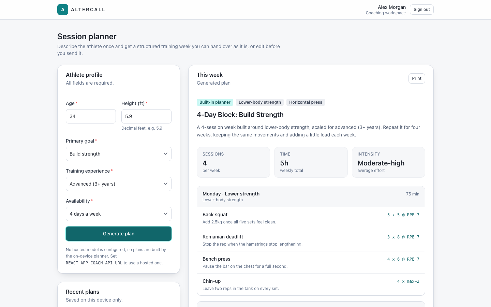

# AlterCall Web

Front end for the AlterCall coaching platform. Coaches sign up, confirm their email with a one-time code, sign in, and then fill in an athlete profile (age, height, goal, experience, available days) to get a weekly training plan with sessions, movements, a load summary and coaching notes.



## Features

- Sign-up, OTP confirmation and sign-in over GraphQL (Apollo Client)
- Weekly plan generator with a provider chain: a hosted coaching API if `REACT_APP_COACH_API_URL` is set, otherwise a built-in rule-based planner (`src/services/coach/planner.js`)
- If the hosted call fails, the local planner answers and the plan is marked as a fallback
- Plan history saved in `localStorage` (last 8 plans)
- Print-friendly plan view

Stack: React 18 (Create React App), Apollo Client, Formik, React Router 6, Tailwind CSS with flowbite-react.

## Getting started

```sh
cp .env.example .env.local
npm install
npm start
```

The app runs on http://localhost:3000. The planner works without any backend. Sign-up and sign-in need a GraphQL server at `REACT_APP_GRAPHQL_URI` (defaults to `http://localhost:8000/graphql`).

To get into the planner without a backend, set a session in the browser console:

```js
localStorage.setItem("altercall.session", JSON.stringify({ accessToken: "dev", userName: "Alex Morgan" }));
```

### Environment

| Variable | Default | Notes |
| --- | --- | --- |
| `REACT_APP_GRAPHQL_URI` | `http://localhost:8000/graphql` | Auth endpoint |
| `REACT_APP_COACH_API_URL` | empty | Hosted coaching endpoint, optional |
| `REACT_APP_COACH_TIMEOUT_MS` | `12000` | Timeout for the hosted call |
| `PORT` | `3000` | Dev server port |

CRA inlines `REACT_APP_*` values at build time, so changing them means rebuilding.

## Tests and checks

```sh
npm run test:ci
npm run test:ci -- --coverage
npm run lint
npm run format:check
npm run build
```

## Docker

The `Dockerfile` builds with Node 20 and serves the bundle from nginx on port 8080. `docker-compose.yml` maps it to `${WEB_PORT:-8560}`. Pass `REACT_APP_*` values as build args.

## Notes

- Auth tokens are kept in `localStorage` and the refresh token is never used, so an expired token just signs you out.
- The mutations have only been tested against a mocked Apollo link, not a live server.
- The built-in planner is template based and doesn't know about injuries or equipment.
